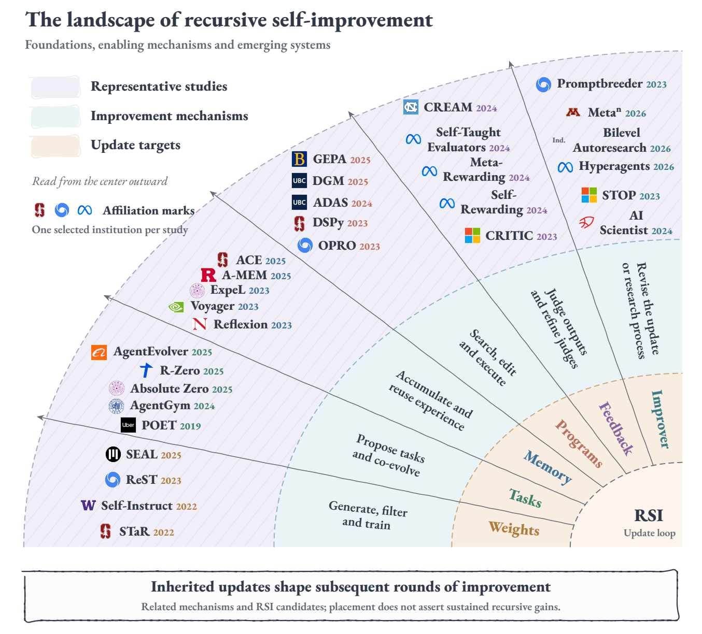

# Awesome RSI in AI [](https://awesome.re)

> A curated collection of papers, benchmarks, and open-source resources on **recursive self-improvement (RSI)** in AI: how retained changes to an AI system can improve its ability to produce subsequent improvements.

This repository accompanies **[Recursive Self-Improvement in AI: A Survey](https://doi.org/10.20944/preprints202609.2680.v1)** by Hao Wu, Fan Xu, Fan Zhang, et al.

[](https://www.preprints.org/manuscript/202609.2680/v1) [](https://doi.org/10.20944/preprints202609.2680.v1) [](CONTRIBUTING.md)

**Survey version:** v1, posted September 30, 2026; not peer reviewed. **Literature cutoff:** September 12, 2026, with the survey's September 20 historical supplement. This companion follows that snapshot; link checks do not extend its literature coverage.



*Figure 3 from [Wu et al. (2026)](https://doi.org/10.20944/preprints202609.2680.v1), extracted from the supplied PDF under CC BY 4.0. Placement identifies a mechanism, not a ranking or proof of sustained recursive gains. [Figure attribution](assets/README.md).*

## About This List

The survey connects two overlapping engineering goals: **automated design of AI infrastructure** and **repair and optimization of existing systems**. The list groups resources by the mechanisms that these goals share: data and training, task curricula, memory and skills, programs and workflows, feedback, and the improvement process itself.

**Inclusion does not imply demonstrated RSI.** Local output revision, persistent solver adaptation, and a better update-producing procedure support different claims. For each configuration, ask what changes, what survives the next task or reset, where feedback comes from, and what remains externally fixed. See the [evaluation guide](docs/evaluation.md) for tests that distinguish these claims.

Start with the survey's Sections 3–4 for definitions and taxonomy, Sections 5–6 for methods, and Section 7 for evaluation. The entries below give a selected reading path; the [complete reference archive](docs/references.md) preserves all **405 numbered entries** in the PDF, with a [machine-readable JSON index](data/references.json). Section 2.2 states 404 works; the archive documents that count discrepancy without changing the source numbering.

Years beside entries indicate the first public version where checked, rather than necessarily the conference year. A **Code** or **Project** link is an author-linked resource; it does not imply that we have reproduced the implementation. **Survey ref.** links lead to the exact bibliography entry.

## Contents

- [Foundations](#foundations)
- [Data, Training and Parameter Adaptation](#data-training-and-parameter-adaptation)
  - [Self-Generated Training Data](#self-generated-training-data)
  - [Learning to Correct and Adapt](#learning-to-correct-and-adapt)
- [Tasks, Curricula and Environment Co-Evolution](#tasks-curricula-and-environment-co-evolution)
- [Memory, Skills and Persistent Context](#memory-skills-and-persistent-context)
- [Prompts, Workflows & Program Search](#prompts-workflows--program-search)
  - [Prompt Optimization](#prompt-optimization)
  - [Agent Architectures & Workflows](#agent-architectures--workflows)
  - [Code, Algorithms & Persistent Harnesses](#code-algorithms--persistent-harnesses)
- [Feedback, Verifiers and Evaluator Improvement](#feedback-verifiers-and-evaluator-improvement)
  - [Critique and External Feedback](#critique-and-external-feedback)
  - [Learning Rewards and Judges](#learning-rewards-and-judges)
- [Editable Improvers & Recursive Context](#editable-improvers--recursive-context)
- [Automated Research & Scientific Discovery](#automated-research--scientific-discovery)
- [Benchmarks & Evaluation](#benchmarks--evaluation)
  - [Interactive Agents & Software Repair](#interactive-agents--software-repair)
  - [Machine Learning Engineering & Scientific Tasks](#machine-learning-engineering--scientific-tasks)
  - [Persistent Adaptation & Evaluator Quality](#persistent-adaptation--evaluator-quality)
- [Failure Modes & Evidence Boundaries](#failure-modes--evidence-boundaries)
- [Related Surveys](#related-surveys)
- [Complete Reference Archive](#complete-reference-archive)
- [Contributing](#contributing)
- [Citation](#citation)
- [Acknowledgments & License](#acknowledgments--license)

## Foundations

Historical foundations connect recursive self-modification to AutoML, learned update rules, and program search. Inclusion here does not imply that a method demonstrates sustained recursive gains.

- [Gödel Machines: Self-Referential Universal Problem Solvers Making Provably Optimal Self-Improvements](https://arxiv.org/abs/cs/0309048) (2003) - A formal model of self-rewriting software that accepts changes after proving their utility under encoded assumptions. [Survey ref. 30](docs/references.md#ref-30)
- [Auto-WEKA: Combined Selection and Hyperparameter Optimization of Classification Algorithms](https://arxiv.org/abs/1208.3719) (2012) - Jointly searches learning algorithms and hyperparameters using Bayesian optimization, providing an AutoML baseline for automated system design. [Survey ref. 34](docs/references.md#ref-34)
- [Bounded Recursive Self-Improvement](https://arxiv.org/abs/1312.6764) (2013) - An architectural blueprint for experience-driven self-modeling and adaptation within designer-specified boundaries. [Survey ref. 31](docs/references.md#ref-31)
- [Neural Architecture Search with Reinforcement Learning](https://arxiv.org/abs/1611.01578) (2016) - Trains a controller to propose neural architectures using validation performance as feedback. [Survey ref. 36](docs/references.md#ref-36)
- [Learning to Learn by Gradient Descent by Gradient Descent](https://arxiv.org/abs/1606.04474) (2016) - Learns an LSTM-based optimizer across training problems, making the parameter-update rule a learned object. [Survey ref. 37](docs/references.md#ref-37)
- [MAML: Model-Agnostic Meta-Learning for Fast Adaptation of Deep Networks](https://arxiv.org/abs/1703.03400) (2017) - Learns an initialization that supports rapid adaptation to new tasks with a small number of gradient steps. [Survey ref. 39](docs/references.md#ref-39)
- [AutoML-Zero: Evolving Machine Learning Algorithms From Scratch](https://arxiv.org/abs/2003.03384) (2020) - Evolves learning programs built from basic mathematical operations, extending automated search beyond model architecture. [Survey ref. 40](docs/references.md#ref-40)
- [Discovering Reinforcement Learning Algorithms](https://arxiv.org/abs/2007.08794) (2020) - Meta-learns both prediction targets and update rules to produce the Learned Policy Gradient algorithm. [Survey ref. 83](docs/references.md#ref-83)

## Data, Training and Parameter Adaptation

### Self-Generated Training Data

- [STaR: Bootstrapping Reasoning With Reasoning](https://arxiv.org/abs/2203.14465) (2022) - Iteratively generates rationales, retains those leading to correct answers, and fine-tunes a reasoner on the resulting data. [Survey ref. 1](docs/references.md#ref-1)
- [Self-Instruct: Aligning Language Models with Self-Generated Instructions](https://arxiv.org/abs/2212.10560) (2022) - Generates and filters instruction examples from a seed set, then uses them to fine-tune instruction-following behavior. [Code](https://github.com/yizhongw/self-instruct) · [Survey ref. 72](docs/references.md#ref-72)
- [Reinforced Self-Training (ReST) for Language Modeling](https://arxiv.org/abs/2308.08998) (2023) - Alternates policy-generated datasets with reward-guided offline learning, allowing generated experience to be reused. [Survey ref. 188](docs/references.md#ref-188)
- [ReST-EM: Beyond Human Data](https://arxiv.org/abs/2312.06585) (2023) - Repeats generation, filtering with binary correctness feedback, and fine-tuning for mathematical reasoning and code generation. [Survey ref. 387](docs/references.md#ref-387)
- [SPIN: Self-Play Fine-Tuning](https://arxiv.org/abs/2401.01335) (2024) - Uses self-generated responses from an earlier model as opponents and human demonstrations as targets for iterative self-play fine-tuning. [Code](https://github.com/uclaml/SPIN) · [Survey ref. 189](docs/references.md#ref-189)
- [Quiet-STaR: Language Models Can Teach Themselves to Think Before Speaking](https://arxiv.org/abs/2403.09629) (2024) - Learns to generate internal rationales that help predict subsequent text, extending rationale learning beyond explicit question-answer pairs. [Survey ref. 388](docs/references.md#ref-388)
- [DeepSeek-Prover](https://arxiv.org/abs/2405.14333) (2024) - Builds synthetic Lean theorem-proving data through formalization, filtering, and proof generation to train a formal prover. [Survey ref. 190](docs/references.md#ref-190)
- [ReST-MCTS*: LLM Self-Training via Process Reward Guided Tree Search](https://arxiv.org/abs/2406.03816) (2024) - Uses process-guided tree search to collect reasoning traces and step-value targets for iterative policy and reward-model training. [Code](https://github.com/THUDM/ReST-MCTS) · [Survey ref. 191](docs/references.md#ref-191)
- [DeepSeek-R1](https://arxiv.org/abs/2501.12948) (2025) - Studies reasoning-focused reinforcement learning and staged training, providing a parameter-learning reference for distinguishing solver gains from changes to the improver. [Survey ref. 192](docs/references.md#ref-192)

### Learning to Correct and Adapt

- [RISE: Recursive Introspection](https://arxiv.org/abs/2407.18219) (2024) - Fine-tunes agents on multi-turn attempts so that unsuccessful responses can inform later corrections within the interaction. [Survey ref. 389](docs/references.md#ref-389)
- [SCoRe: Training Language Models to Self-Correct via Reinforcement Learning](https://arxiv.org/abs/2409.12917) (2024) - Uses multi-turn online reinforcement learning and self-generated correction traces to train self-correction behavior. [Survey ref. 390](docs/references.md#ref-390)
- [TTRL: Test-Time Reinforcement Learning](https://arxiv.org/abs/2504.16084) (2025) - Updates model parameters on unlabeled test inputs using rewards estimated from generated answers, including majority-vote signals. [Code](https://github.com/PRIME-RL/TTRL) · [Survey ref. 391](docs/references.md#ref-391)
- [SEAL: Self-Adapting Language Models](https://arxiv.org/abs/2506.10943) (2025) - Learns to generate fine-tuning data and update directives, rewarding self-edits by the adapted model's downstream performance. [Project](https://jyopari.github.io/posts/seal) · [Survey ref. 392](docs/references.md#ref-392)


## Tasks, Curricula and Environment Co-Evolution

- [Paired Open-Ended Trailblazer (POET)](https://arxiv.org/abs/1901.01753) (2019) - Co-evolves environmental challenges and their solvers, transferring solutions between tasks to create new learning opportunities. [Survey ref. 41](docs/references.md#ref-41)
- [Enhanced POET](https://arxiv.org/abs/2003.08536) (2020) - Extends POET with challenge novelty, transfer heuristics, and measures for studying continued open-ended innovation. [Survey ref. 42](docs/references.md#ref-42)
- [AgentGym: Evolving Large Language Model-based Agents across Diverse Environments](https://arxiv.org/abs/2406.04151) (2024) - Provides environments, trajectories, benchmarks, and AgentEvol for studying experience-based agent learning across tasks. [Code](https://github.com/WooooDyy/AgentGym) · [Survey ref. 393](docs/references.md#ref-393)
- [Absolute Zero: Reinforced Self-play Reasoning with Zero Data](https://arxiv.org/abs/2505.03335) (2025) - Jointly trains task proposal and solving, using code execution to validate generated tasks and check answers. [Survey ref. 75](docs/references.md#ref-75)
- [R-Zero: Self-Evolving Reasoning LLM from Zero Data](https://arxiv.org/abs/2508.05004) (2025) - Co-evolves a challenger and solver, with task difficulty adapted to the solver's current capabilities. [Survey ref. 76](docs/references.md#ref-76)
- [AgentEvolver: Towards Efficient Self-Evolving Agent System](https://arxiv.org/abs/2511.10395) (2025) - Combines self-questioning, experience-guided exploration, and trajectory credit assignment in an agent learning pipeline. [Survey ref. 394](docs/references.md#ref-394)


## Memory, Skills and Persistent Context

- [Reflexion: Language Agents with Verbal Reinforcement Learning](https://arxiv.org/abs/2303.11366) (2023) - Stores verbal reflections on feedback in episodic memory to guide later trials without changing model weights. [Survey ref. 3](docs/references.md#ref-3)
- [Voyager: An Open-Ended Embodied Agent with Large Language Models](https://arxiv.org/abs/2305.16291) (2023) - Combines an automatic curriculum, executable skill library, and environment-grounded program revision in Minecraft. [Project](https://voyager.minedojo.org/) · [Survey ref. 4](docs/references.md#ref-4)
- [ExpeL: LLM Agents Are Experiential Learners](https://arxiv.org/abs/2308.10144) (2023) - Distills natural-language insights from training-task experience and retrieves these insights and past trajectories for later decisions. [Survey ref. 77](docs/references.md#ref-77)
- [A-MEM: Agentic Memory for LLM Agents](https://arxiv.org/abs/2502.12110) (2025) - Organizes experience into linked notes whose attributes and connections can evolve as new memories arrive. [Code](https://github.com/WujiangXu/A-mem-sys) · [Survey ref. 395](docs/references.md#ref-395)
- [Dynamic Cheatsheet: Test-Time Learning with Adaptive Memory](https://arxiv.org/abs/2504.07952) (2025) - Maintains a self-curated store of reusable strategies and code snippets across queries without parameter updates. [Code](https://github.com/suzgunmirac/dynamic-cheatsheet) · [Survey ref. 396](docs/references.md#ref-396)
- [ACE: Agentic Context Engineering](https://arxiv.org/abs/2510.04618) (2025) - Evolves structured context playbooks through generation, reflection, and incremental curation, supporting offline and online adaptation. [Survey ref. 397](docs/references.md#ref-397)
- [MetaClaw: Just Talk — An Agent That Meta-Learns and Evolves in the Wild](https://arxiv.org/abs/2603.17187) (2026) - Couples failure-driven skill synthesis with policy updates scheduled during inactive periods, maintaining both reusable skills and model parameters. [Code](https://github.com/aiming-lab/MetaClaw) · [Survey ref. 398](docs/references.md#ref-398)
- [Mem²Evolve](https://arxiv.org/abs/2604.10923) (2026) - Couples distilled experience with dynamic tool and expert-agent creation through experience memory and asset memory. [Survey ref. 78](docs/references.md#ref-78)


## Prompts, Workflows & Program Search

These methods make prompts, executable workflows, or agent code editable. A stronger discovered artifact and a stronger procedure for discovering the next artifact require different tests.

### Prompt Optimization

- [APE: Large Language Models Are Human-Level Prompt Engineers](https://arxiv.org/abs/2211.01910) (2022) - Generates and scores candidate natural-language instructions as an automatic prompt-search procedure. [Survey ref. 143](docs/references.md#ref-143)
- [APO: Automatic Prompt Optimization with "Gradient Descent" and Beam Search](https://arxiv.org/abs/2305.03495) (2023) - Uses textual critiques of prompt errors, beam search, and selection to revise instructions. [Survey ref. 144](docs/references.md#ref-144)
- [OPRO: Large Language Models as Optimizers](https://arxiv.org/abs/2309.03409v3) (2023) - Conditions new candidate solutions on earlier candidates and their scores, including for prompt optimization. [Code](https://github.com/google-deepmind/opro) · [Survey ref. 86](docs/references.md#ref-86)
- [EvoPrompt: Connecting LLMs with Evolutionary Algorithms Yields Powerful Prompt Optimizers](https://arxiv.org/abs/2309.08532) (2023) - Uses LLMs to implement evolutionary operators over a population of prompts selected with development-set feedback. [Survey ref. 145](docs/references.md#ref-145)
- [PromptAgent: Strategic Planning with Language Models Enables Expert-level Prompt Optimization](https://arxiv.org/abs/2310.16427) (2023) - Combines error reflection with Monte Carlo tree search over candidate prompts. [Survey ref. 146](docs/references.md#ref-146)
- [TextGrad: Automatic "Differentiation" via Text](https://arxiv.org/abs/2406.07496) (2024) - Propagates natural-language feedback through a computation graph to revise prompts, code, and other system variables. [Survey ref. 87](docs/references.md#ref-87)
- [GEPA: Reflective Prompt Evolution Can Outperform Reinforcement Learning](https://arxiv.org/abs/2507.19457) (2025) - Reflects on execution trajectories and combines complementary candidates from a Pareto frontier to evolve prompts. [Code](https://github.com/gepa-ai/gepa) · [Survey ref. 82](docs/references.md#ref-82)

### Agent Architectures & Workflows

- [DSPy: Compiling Declarative Language Model Calls into Self-Improving Pipelines](https://arxiv.org/abs/2310.03714) (2023) - Expresses language-model pipelines as declarative modules and compiles them against a task metric. [Code](https://github.com/stanfordnlp/dspy) · [Survey ref. 399](docs/references.md#ref-399)
- [ADAS: Automated Design of Agentic Systems](https://arxiv.org/abs/2408.08435v2) (2024) - Uses a meta-agent and an archive of prior designs to search over executable agent programs. [Survey ref. 80](docs/references.md#ref-80)
- [AgentSquare: Automatic LLM Agent Search in Modular Design Space](https://arxiv.org/abs/2410.06153) (2024) - Evolves and recombines planning, reasoning, tool-use, and memory modules within a shared interface. [Survey ref. 81](docs/references.md#ref-81)
- [AFlow: Automating Agentic Workflow Generation](https://arxiv.org/abs/2410.10762) (2024) - Searches code-represented workflows with Monte Carlo tree search, execution feedback, and accumulated search experience. [Code](https://github.com/FoundationAgents/AFlow) · [Survey ref. 400](docs/references.md#ref-400)

### Code, Algorithms & Persistent Harnesses

- [SICA: A Self-Improving Coding Agent](https://arxiv.org/abs/2504.15228) (2025) - Lets a coding agent edit its own implementation and evaluate the revised agent on coding tasks. [Survey ref. 282](docs/references.md#ref-282)
- [AlphaEvolve: A Coding Agent for Scientific and Algorithmic Discovery](https://arxiv.org/abs/2506.13131) (2025) - Combines LLM-generated code edits with evolutionary search and executable evaluators for algorithm discovery. [Survey ref. 142](docs/references.md#ref-142)
- [Prime Agent: A Self-Improving RLM Harness](https://arxiv.org/abs/2608.23552) (2026) - Combines a persistent Python execution environment, recursive subagents, and retained histories, memories, skills, and prompts across trajectories. [Code](https://github.com/PrimeIntellect-ai/prime-agent) · [Survey ref. 401](docs/references.md#ref-401)


## Feedback, Verifiers and Evaluator Improvement

### Critique and External Feedback

- [Constitutional AI: Harmlessness from AI Feedback](https://arxiv.org/abs/2212.08073) (2022) - Uses an explicit constitution to guide self-critiques, response revisions, and AI-generated preferences for subsequent training. [Survey ref. 116](docs/references.md#ref-116)
- [Self-Refine: Iterative Refinement with Self-Feedback](https://arxiv.org/abs/2303.17651) (2023) - Alternates feedback and revision of the current output; useful as a local-refinement baseline when testing persistent improvement. [Survey ref. 67](docs/references.md#ref-67)
- [CRITIC: Large Language Models Can Self-Correct with Tool-Interactive Critiquing](https://arxiv.org/abs/2305.11738) (2023) - Grounds output revision in tool feedback such as execution results and retrieved evidence. [Survey ref. 68](docs/references.md#ref-68)

### Learning Rewards and Judges

- [Self-Rewarding Language Models](https://arxiv.org/abs/2401.10020) (2024) - Uses the language model as a judge to produce preference data for iterative direct preference optimization. [Survey ref. 2](docs/references.md#ref-2)
- [V-STaR: Training Verifiers for Self-Taught Reasoners](https://arxiv.org/abs/2402.06457) (2024) - Trains verifiers from both correct and incorrect self-generated solutions, then uses them to select candidate answers. [Survey ref. 196](docs/references.md#ref-196)
- [Meta-Rewarding Language Models](https://arxiv.org/abs/2407.19594v2) (2024) - Adds a meta-judge that evaluates judgments, using the resulting feedback to refine judging and instruction-following behavior. [Survey ref. 79](docs/references.md#ref-79)
- [Self-Taught Evaluators](https://arxiv.org/abs/2408.02666) (2024) - Iteratively trains a judge on synthetic contrasting responses, reasoning traces, and judgments without labeled human preference data. [Survey ref. 402](docs/references.md#ref-402)
- [CREAM: Consistency Regularized Self-Rewarding Language Models](https://arxiv.org/abs/2410.12735) (2024) - Uses reward consistency across iterations to regularize self-generated preference labels and limit overconfident self-rewarding. [Code](https://github.com/Raibows/CREAM) · [Survey ref. 403](docs/references.md#ref-403)
- [Process-based Self-Rewarding Language Models](https://arxiv.org/abs/2503.03746) (2025) - Combines stepwise judging and preference optimization to extend self-rewarding to mathematical reasoning processes. [Survey ref. 404](docs/references.md#ref-404)

## Editable Improvers & Recursive Context

These papers expose changes to update-producing machinery or recursively condition later updates on earlier code and traces. Their editable scope, fixed components, and evidence for improved update production differ.

- [Promptbreeder: Self-Referential Self-Improvement Via Prompt Evolution](https://arxiv.org/abs/2309.16797) (2023) - Evolves both task prompts and the mutation prompts used to generate their subsequent revisions. [Survey ref. 84](docs/references.md#ref-84)
- [STOP: Self-Taught Optimizer — Recursively Self-Improving Code Generation](https://arxiv.org/abs/2310.02304) (2023) - Applies a language-model-based program improver to its own code and evaluates the resulting improver on downstream program-improvement tasks. [Survey ref. 46](docs/references.md#ref-46)
- [Darwin Gödel Machine: Open-Ended Evolution of Self-Improving Agents](https://arxiv.org/abs/2505.22954v3) (2025) - Maintains an archive of self-modified coding agents and empirically evaluates descendants, allowing coding changes to affect later self-modification. [Code](https://github.com/jennyzzt/dgm) · [Survey ref. 5](docs/references.md#ref-5)
- [Hyperagents](https://arxiv.org/abs/2603.19461v1) (2026) - Places task-agent and meta-agent code in a shared editable program and studies transfer of evolved meta-level improvements. [Code](https://github.com/facebookresearch/Hyperagents) · [Survey ref. 6](docs/references.md#ref-6)
- [Bilevel Autoresearch: Meta-Autoresearching Itself](https://arxiv.org/abs/2603.23420) (2026) - Uses an outer loop to inspect inner-loop code and traces and inject new search mechanisms; the reported experiments demonstrate one bilevel improvement step. [Survey ref. 405](docs/references.md#ref-405)
- [Metaⁿ: Recursive Self-Improvement through Emergent Depth](https://arxiv.org/abs/2608.24735v1) (2026) - Keeps the meta-operation fixed while recursively expanding its input with earlier programs and execution traces to construct additional strategic layers. [Code](https://github.com/minnesotanlp/meta-n) · [Survey ref. 7](docs/references.md#ref-7)


## Automated Research & Scientific Discovery

Research automation can improve designs and research outputs without establishing that its own update procedure improves across rounds. Scientific validity also requires checks beyond the system's internal reviewer.

- [The AI Scientist: Towards Fully Automated Open-Ended Scientific Discovery](https://arxiv.org/abs/2408.06292) (2024) - Connects idea generation, code editing, experiment execution, analysis, manuscript writing, and automated review in one research workflow. [Code](https://github.com/SakanaAI/AI-Scientist) · [Survey ref. 167](docs/references.md#ref-167)
- [The AI Scientist-v2: Workshop-Level Automated Scientific Discovery via Agentic Tree Search](https://arxiv.org/abs/2504.08066) (2025) - Uses agentic experiment-tree search and a template-free research workflow with visual feedback for figures. [Code](https://github.com/SakanaAI/AI-Scientist-v2) · [Survey ref. 168](docs/references.md#ref-168)
- [Accelerating Scientific Discovery with Co-Scientist](https://arxiv.org/abs/2502.18864) (2025) - Uses multiple agents and tournament-style refinement to generate, critique, and prioritize scientific hypotheses for experimental verification. [Survey ref. 172](docs/references.md#ref-172)
- [ASI-Evolve: AI Accelerates AI](https://arxiv.org/abs/2603.29640) (2026) - Retains experimental insights in a learn-design-experiment-analyze loop for data pipelines, model architectures, and learning algorithms. [Survey ref. 170](docs/references.md#ref-170)
- [AREX: Towards a Recursively Self-Improving Agent for Deep Research](https://arxiv.org/abs/2607.21461) (2026) - Alternates evidence-gathering research with constraint-wise answer auditing while a learned context-update tool preserves verified findings and unresolved claims. [Survey ref. 85](docs/references.md#ref-85)

## Benchmarks & Evaluation

These benchmarks supply task endpoints or longitudinal environments. An RSI experiment must additionally specify update history, retained state, independent tests, and full development cost; a benchmark score alone does not establish recursive improvement. See the [evaluation guide](docs/evaluation.md).

### Interactive Agents & Software Repair

- [AgentBench: Evaluating LLMs as Agents](https://arxiv.org/abs/2308.03688) (2023) - Evaluates interactive agents across multiple environments, providing task outcomes for testing inherited changes. [Survey ref. 316](docs/references.md#ref-316)
- [GAIA: A Benchmark for General AI Assistants](https://arxiv.org/abs/2311.12983) (2023) - Tests assistants on questions requiring reasoning, browsing, tools, and multimodal information. [Survey ref. 317](docs/references.md#ref-317)
- [SWE-bench: Can Language Models Resolve Real-World GitHub Issues?](https://arxiv.org/abs/2310.06770) (2023) - Evaluates repository-level issue resolution using real software tasks and executable tests. [Survey ref. 318](docs/references.md#ref-318)
- [WebArena: A Realistic Web Environment for Building Autonomous Agents](https://arxiv.org/abs/2307.13854) (2023) - Provides reproducible web environments for evaluating long-horizon interaction and task completion. [Survey ref. 327](docs/references.md#ref-327)
- [τ-bench: A Benchmark for Tool-Agent-User Interaction in Real-World Domains](https://arxiv.org/abs/2406.12045) (2024) - Tests tool use, domain-policy compliance, and reliability during simulated user interactions. [Survey ref. 329](docs/references.md#ref-329)
- [LiveCodeBench](https://arxiv.org/abs/2403.07974) (2024) - Uses continuously collected programming problems and release-aware evaluation to study code capabilities with reduced contamination risk. [Survey ref. 349](docs/references.md#ref-349)

### Machine Learning Engineering & Scientific Tasks

- [MLAgentBench: Evaluating Language Agents on Machine Learning Experimentation](https://arxiv.org/abs/2310.03302) (2023) - Evaluates agents that design, execute, and iterate on machine learning experiments. [Survey ref. 319](docs/references.md#ref-319)
- [MLE-bench: Evaluating Machine Learning Agents on Machine Learning Engineering](https://arxiv.org/abs/2410.07095) (2024) - Uses machine learning competition tasks to assess data handling, training, and empirical model improvement. [Survey ref. 320](docs/references.md#ref-320)
- [ScienceAgentBench](https://arxiv.org/abs/2410.05080) (2024) - Evaluates executable scientific workflows for data-driven discovery across research tasks. [Survey ref. 321](docs/references.md#ref-321)
- [AI4AI-Bench](https://arxiv.org/abs/2608.20318) (2026) - Tests agents' ability to design training algorithms, with independent execution of the resulting code. [Survey ref. 343](docs/references.md#ref-343)

### Persistent Adaptation & Evaluator Quality

- [LifelongAgentBench: Evaluating LLM Agents as Lifelong Learners](https://arxiv.org/abs/2505.11942) (2025) - Evaluates accumulation and transfer of experience across interdependent agent tasks. [Survey ref. 338](docs/references.md#ref-338)
- [SEA-Eval](https://arxiv.org/abs/2604.08988) (2026) - Tracks self-evolving agents across task streams, exposing success and cost beyond isolated episodes. [Survey ref. 325](docs/references.md#ref-325)
- [SEAGym: An Evaluation Environment for Self-Evolving LLM Agents](https://arxiv.org/abs/2606.17546) (2026) - Separates training, update validation, held-out tests, replay, and cost records to assess reusable harness changes. [Survey ref. 326](docs/references.md#ref-326)
- [RewardBench: Evaluating Reward Models for Language Modeling](https://arxiv.org/abs/2403.13787) (2024) - Tests reward-model preferences across response categories, supporting checks of the signal used to select updates. [Survey ref. 322](docs/references.md#ref-322)
- [ProcessBench: Identifying Process Errors in Mathematical Reasoning](https://arxiv.org/abs/2412.06559) (2024) - Tests whether evaluators identify erroneous reasoning steps, rather than only rank final answers. [Survey ref. 323](docs/references.md#ref-323)

## Failure Modes & Evidence Boundaries

- [Large Language Models Cannot Self-Correct Reasoning Yet](https://arxiv.org/abs/2310.01798) (2023) - Finds that intrinsic self-correction can fail or degrade reasoning in the studied settings, motivating independent feedback and appropriate controls. [Survey ref. 352](docs/references.md#ref-352)
- [The Curse of Recursion: Training on Generated Data Makes Models Forget](https://arxiv.org/abs/2305.17493) (2023) - Studies distributional degradation when generated data recursively replaces original data in model training. [Survey ref. 355](docs/references.md#ref-355)
- [Is Model Collapse Inevitable? Breaking the Curse of Recursion by Accumulating Real and Synthetic Data](https://arxiv.org/abs/2404.01413) (2024) - Shows that retaining and accumulating data changes collapse outcomes in the studied regimes, qualifying replacement-based failure conclusions. [Survey ref. 357](docs/references.md#ref-357)

## Related Surveys

- [A Survey of Self-Evolving Agents: What, When, How, and Where to Evolve on the Path to Artificial Super Intelligence](https://arxiv.org/abs/2507.21046v4) (2025) - Organizes agent evolution by targets, timing, mechanisms, and applications. [Survey ref. 8](docs/references.md#ref-8)
- [Self-Improvement of Large Language Models: A Technical Overview and Future Outlook](https://arxiv.org/abs/2603.25681v3) (2026) - Reviews self-improvement through the model-development lifecycle and autonomous evaluation. [Survey ref. 9](docs/references.md#ref-9)
- [Recursive Self-Improvement in AI: From Bounded Self-Refinement to Autonomous Research Loops](https://arxiv.org/abs/2607.07663v2) (2026) - Connects update targets and loop closure with verification, grounding, and failure modes. [Survey ref. 11](docs/references.md#ref-11)
- [A Survey on the Memory Mechanism of Large Language Model Based Agents](https://arxiv.org/abs/2404.13501) (2024) - Reviews how agent memories are designed, used, and evaluated. [Survey ref. 12](docs/references.md#ref-12)
- [A Systematic Survey of Automatic Prompt Optimization Techniques](https://arxiv.org/abs/2502.16923) (2025) - Provides a complementary taxonomy of automated prompt-search methods. [Survey ref. 13](docs/references.md#ref-13)


## Complete Reference Archive

- [All numbered survey references](docs/references.md) - Browse the source bibliography with stable citation anchors.
- [Reference metadata in JSON](data/references.json) - Retrieve titles, authors as cited, years, source URLs, and import provenance.
- [Curation and verification notes](docs/curation.md) - Understand the coverage, checks, and limitations of this companion.

## Contributing

Contributions are welcome. Prefer primary papers, author-linked implementations, and benchmarks that make the update mechanism or evaluation protocol inspectable. Keep descriptions concise, explain what changes and persists, and distinguish reported results from claims about unrestricted RSI. See [CONTRIBUTING.md](CONTRIBUTING.md).

## Citation

If this survey or resource collection helps your research, please cite the survey. The full 32-author record is available in [survey.bib](survey.bib) and [CITATION.cff](CITATION.cff).

```bibtex
@misc{wu2026recursive,
  title = {Recursive Self-Improvement in {AI}: A Survey},
  author = {Wu, Hao and Xu, Fan and Zhang, Fan and Xu, Zhipeng and Zhang, Yongheng and Li, Yinghui and Zhao, Yizhou and Zhao, Penghao and Yao, Weiran and Li, Zengxiang and Gao, Yuan and Gao, Zhangyang and Wang, Hanbin and Tao, Ruihan and Wang, Wenjie and Li, Qi and Fang, Junfeng and Ma, Xingjun and Li, Qiankun and Luo, Xiao and Zheng, Yefeng and Liu, Zhiwei and Wang, Stephen and Wang, Kun and Liu, Yang and Jiang, Yugang and Wang, Liang and Liu, Nan and Yu, Philip S. and Xiong, Caiming and Yang, Qiang and Wen, Qingsong},
  year = {2026},
  month = sep,
  doi = {10.20944/preprints202609.2680.v1},
  url = {https://doi.org/10.20944/preprints202609.2680.v1},
  howpublished = {Preprints.org},
  note = {Version 1, posted 30 September 2026. Not peer reviewed}
}
```

## Acknowledgments & License

The list's organization and concise resource-entry format are inspired by [Awesome Harness Engineering](https://github.com/walkinglabs/awesome-harness-engineering). The topic taxonomy and figure come from the accompanying survey.

Repository prose and the attributed survey figure are available under [CC BY 4.0](LICENSE.md). Linked papers, implementations, and third-party marks retain their own rights and licenses.
